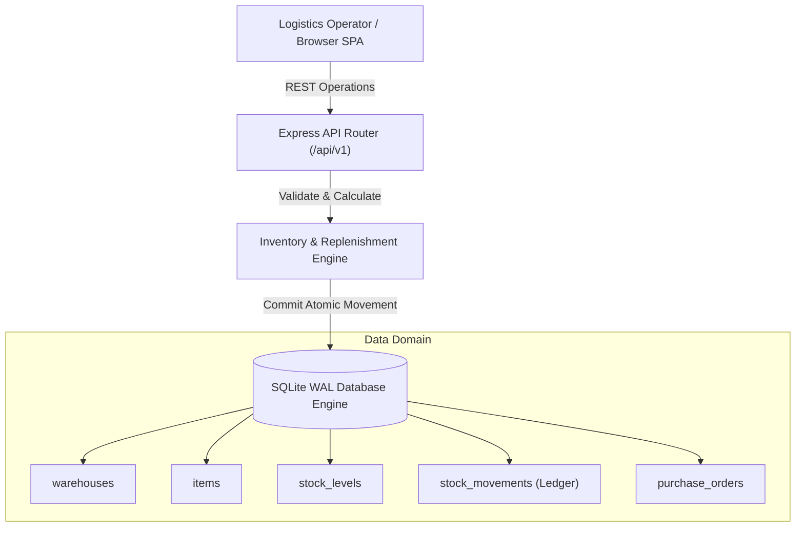

# StockPilot | Multi-Warehouse Inventory & Supply Chain Management System

[](https://github.com/Soulofghost/stockpilot/actions)
[](LICENSE)
[](https://nodejs.org/)
[](https://expressjs.com/)
[](https://www.sqlite.org/)

---

## 1. Project Introduction

**StockPilot** is an enterprise-grade warehouse management system (WMS) and supply chain inventory ledger engineered to manage stock balance across distributed fulfillment centers. Built on high-concurrency Node.js and SQLite Write-Ahead Logging (WAL), StockPilot provides real-time multi-hub stock visibility, automated safety stock replenishment alerts, and an immutable double-entry movement ledger.

---

## 2. Problem Statement

Modern distribution and retail organizations face critical operational hurdles when scaling across multiple logistics facilities:
- **Inventory Discrepancy & Blind Spots:** Decentralized tracking leads to phantom stock, unrecorded warehouse-to-warehouse transfers, and inaccurate order promises.
- **Stockout & Overstock Vulnerabilities:** Manual reorder monitoring results in production standstills from unexpected component shortages or tied-up capital from over-purchasing.
- **Lack of Movement Auditability:** Traditional spreadsheet or ERP add-ons lack transactional integrity, making it difficult to trace damaged, missing, or misallocated batches.

---

## 3. Proposed Solution

StockPilot delivers end-to-end multi-facility inventory governance:
- **Transactional Double-Entry Ledger:** Every stock intake, transfer, and outbound dispatch records an immutable ledger entry with timestamp and reference manifest.
- **Dynamic Safety Stock Monitoring:** Real-time stock health grading (`NORMAL`, `LOW`, `CRITICAL`, `OUT_OF_STOCK`) comparing on-hand counts against per-SKU reorder thresholds.
- **Automated Purchase Order Fulfillment:** One-click conversion of inventory deficit warnings into formal purchase orders that automatically increment physical stock upon receipt.

---

## 4. Key Features

- **Multi-Hub Inventory Aggregation:** Real-time consolidation of stock levels across regional fulfillment centers and storage bins.
- **Inter-Warehouse Rebalancing:** Atomic stock transfer with source balance verification preventing negative inventory.
- **Replenishment Alert Engine:** Automatic detection of SKUs below threshold with quick purchase order generation.
- **Purchase Order Workflow:** Status tracking (`draft`, `ordered`, `received`, `cancelled`) with automated receiving intake.
- **Facility Utilization Analytics:** Visual capacity tracking across warehouses with occupancy percentages and total valuation.

---

## 5. Architecture Diagram



---

## 6. Technology Stack

- **Backend Runtime:** Node.js v22+ (ES Modules)
- **Web Framework:** Express.js 4.19
- **Database Engine:** `node:sqlite` (SQLite 3 with Write-Ahead Logging)
- **Frontend Architecture:** Modern Vanilla ES6 SPA, HTML5, CSS Variables, Space Grotesk & JetBrains Mono typography
- **DevOps:** Docker, Docker Compose, GitHub Actions CI
- **Automated Testing:** Node.js native test runner (`node:test`, `node:assert/strict`)

---

## 7. Folder Structure

```
stockpilot/
├── .github/
│   └── workflows/
│       └── ci.yml
├── backend/
│   ├── src/
│   │   ├── engine/
│   │   │   └── inventory.js
│   │   ├── routes/
│   │   │   └── inventoryRoutes.js
│   │   ├── db.js
│   │   └── server.js
│   ├── tests/
│   │   └── inventory.test.js
│   ├── package.json
│   └── package-lock.json
├── frontend/
│   ├── app.js
│   ├── index.html
│   └── style.css
├── .env.example
├── .gitignore
├── docker-compose.yml
├── Dockerfile
├── LICENSE
└── README.md
```

---

## 8. Installation Instructions

### Prerequisites
- Node.js 22.x or later
- npm or yarn

### Setup Steps
```bash
git clone https://github.com/Soulofghost/stockpilot.git
cd stockpilot/backend
npm install
npm start
```

The system will start on `http://localhost:8006`.

---

## 9. Environment Configuration

Copy `.env.example` to `.env`:
```bash
cp .env.example .env
```

| Variable | Default Value | Description |
| :--- | :--- | :--- |
| `PORT` | `8006` | HTTP service port |
| `STOCKPILOT_DB` | `./backend/data/stockpilot.db` | SQLite database file location |
| `NODE_ENV` | `development` | Runtime environment mode |

---

## 10. Database Setup

Database tables and initial enterprise distribution hub records are seeded automatically upon server launch via `initDb()`:
```javascript
import { initDb } from './src/db.js';
initDb();
```

---

## 11. API Documentation

### Primary Endpoints

| Method | Endpoint | Description |
| :--- | :--- | :--- |
| `GET` | `/api/v1/health` | Service health status check |
| `GET` | `/api/v1/analytics` | Total valuation, SKUs, and active alert metrics |
| `GET` | `/api/v1/warehouses` | Distribution hubs with capacity utilization |
| `GET` | `/api/v1/items` | Inventory catalog with on-hand counts & health |
| `POST` | `/api/v1/items` | Register new SKU item |
| `GET` | `/api/v1/movements` | Chronological stock movement ledger |
| `POST` | `/api/v1/movements/intake` | Record supplier inbound consignment |
| `POST` | `/api/v1/movements/transfer` | Atomic transfer between facilities |
| `POST` | `/api/v1/movements/outflow` | Outbound dispatch & fulfillment |
| `GET` | `/api/v1/alerts` | Active safety stock deficit alerts |
| `GET` | `/api/v1/purchase-orders` | Purchase order tracking |
| `POST` | `/api/v1/purchase-orders` | Issue new purchase order |
| `PATCH` | `/api/v1/purchase-orders/:poNumber/status` | Update PO status (triggers auto-intake on 'received') |

---

## 12. Application Interface Overview

StockPilot offers an industrial, high-contrast user interface:
- **Executive Metric Bar:** Immediate valuation, units, critical deficit count, and pending POs.
- **Inventory Master Tab:** Filterable SKU master table with real-time valuation per line item.
- **Replenishment Alerts Tab:** Prioritized deficit warnings with instant reorder PO generation.
- **Purchase Order Workflow:** Lifecycle management with automatic stock incrementing on receipt.
- **Ledger Audit Log:** Timestamped immutable records for all physical movements.

---

## 13. Testing Instructions

Execute the automated test suite using the Node.js native test runner:

```bash
cd backend
npm test
```

Expected output:
```
▶ StockPilot Inventory Engine Tests
  ✔ Database seeds initial warehouses and items
  ✔ recordIntake increments warehouse stock level and logs movement
  ✔ recordTransfer moves stock from source to destination warehouse
  ✔ recordTransfer throws error when requested quantity exceeds source stock
  ✔ recordOutflow deducts stock for outbound fulfillment
  ✔ recordOutflow prevents negative inventory balance
  ✔ checkReorderAlerts identifies items at or below reorder threshold
  ✔ computeInventoryMetrics calculates warehouse totals and valuations
✔ StockPilot Inventory Engine Tests (45ms)
ℹ tests 8
ℹ pass 8
ℹ fail 0
```

---

## 14. Security Considerations

- **Strict Input Sanitization:** Type casting and validation on all quantities, preventing negative adjustments or invalid transfers.
- **Referential Integrity:** Foreign key enforcement on all items, warehouses, movements, and purchase orders.
- **Zero Secret Commits:** Strict `.gitignore` rules prevent SQLite database files or local environment variables from being checked into version control.

---

## 15. Deployment Instructions

### Docker Deployment
```bash
docker compose up -d --build
```
Access the application at `http://localhost:8006`.

---

## 16. Known Limitations

- Multi-instance load balancing with concurrent writes is bounded by SQLite WAL concurrency; high-volume distributed deployments benefit from external message queuing (e.g. RabbitMQ/Kafka).
- Barcode/QR scanning is currently supported via text SKU inputs; camera-based scanning planned in next release.

---

## 17. Future Roadmap

- [ ] Barcode / QR scanner integration via WebRTC camera feed.
- [ ] Automated batch and expiration date (FEFO/FIFO) picking optimization.
- [ ] Multi-currency support for international procurement orders.
- [ ] EDI 850 / 856 electronic data interchange support for enterprise logistics partners.

---

## 18. License

SPDX-License-Identifier: MIT
Copyright (c) 2026 Alvin MS (@Soulofghost). All rights reserved.
